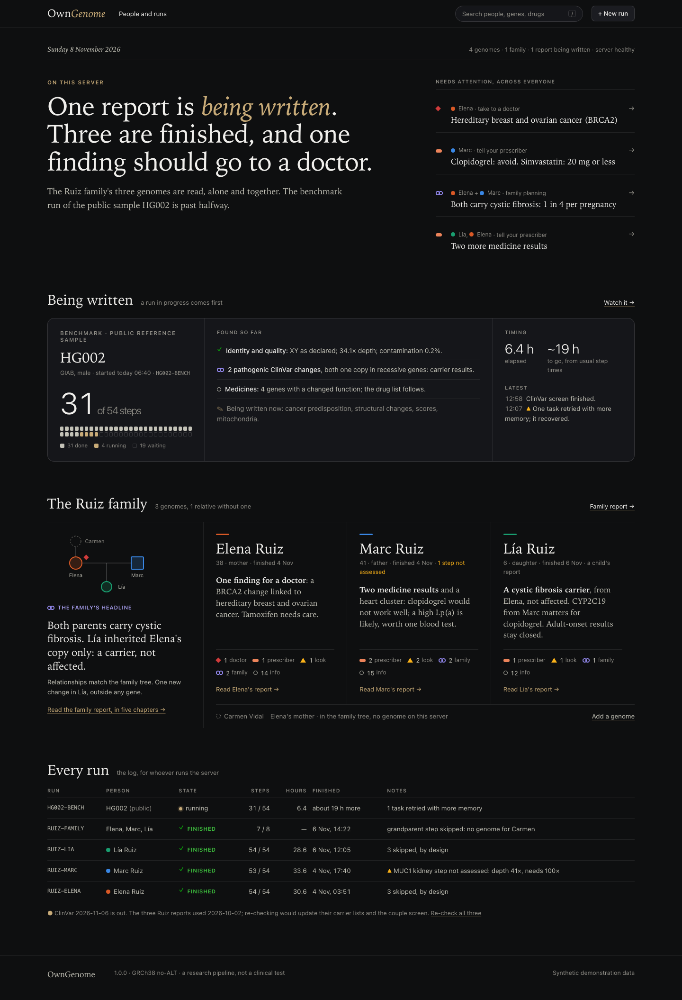
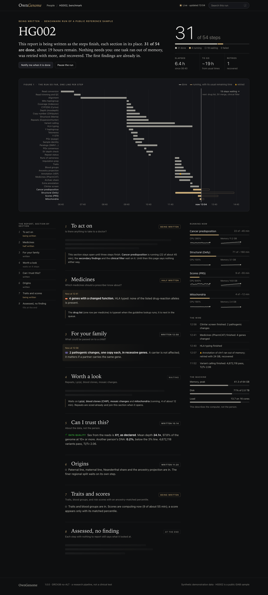
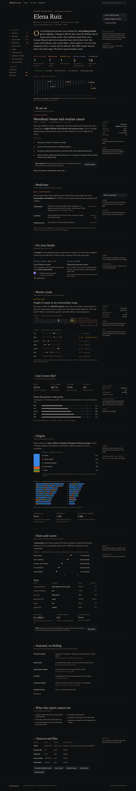
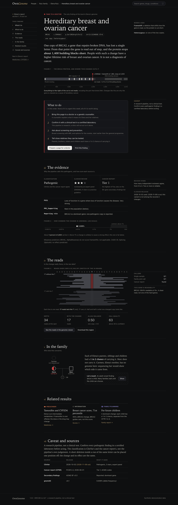
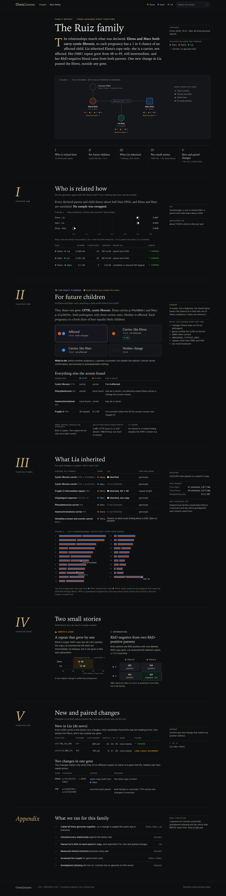
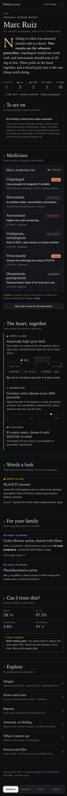
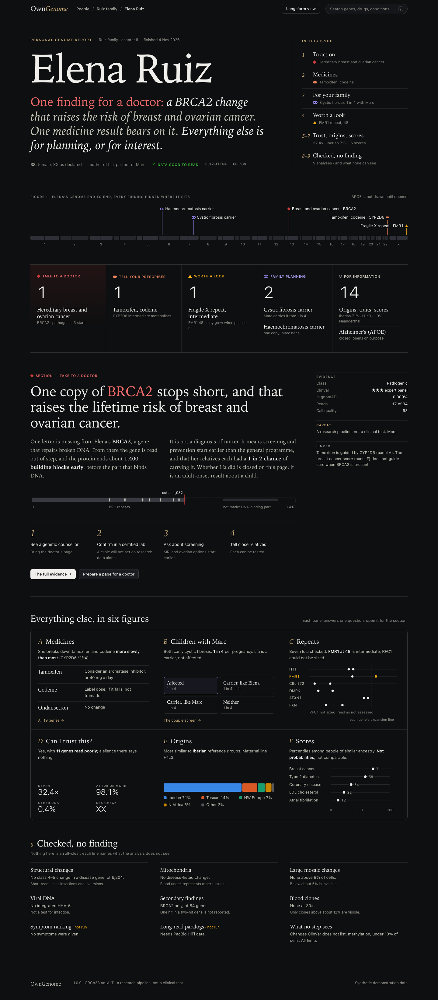

# Live site design: Journal

This is the design the live site is built to. Each person's genome reads as a long, typeset report: a serif headline, a plain-words lead that names what matters, numbered sections with figures in the text, and caveats and evidence in the margin. A family is a report in chapters. A run in progress is the same report, filling in section by section.

The screens use invented people (the Ruiz family: Elena, Marc and their daughter Lía) and the public GIAB sample HG002. No real genome went into them. How the pages connect, what each one answers first and the five design decisions are in [UX.md](UX.md). The data inventory behind the design is in [BRIEF.md](BRIEF.md).

When the site and these screens disagree, the screens win, unless the data says otherwise. Then fix the screens here in the same PR.

## The screens

### 01 People and runs
Does anyone have something to act on, and what is running?

### 02 A run being written
Is it moving, when will it end, is anything wrong? Sections fill in where they will sit in the finished report.

### 03 A person's report
Is there anything serious? The lead names it, then ten numbered sections, from "To act on" to "Sources".

### 04 One finding
What do I do about it? The plan sits under the explanation, with the evidence below it.

### 05 A family
What does it mean for our children? Five chapters: pedigree, relatedness, couple screen, inheritance, de novo and compound het.

### 06 A person on a phone
Which medicines should I watch out for? One column, with a tab bar at the bottom.

### 07 A bolder person report
A cover-style variant of 03, kept for comparison.

## The site before this design

[today/](today/) holds the same pages as the live site drew them before this redesign.

## Editing the screens

The HTML sources live in `src/`, with shared styles in `src/_journal.css` and `src/_journal.js`. `node build.js` inlines them into `html/`. Open any file in `html/` in a browser; it needs no network.
